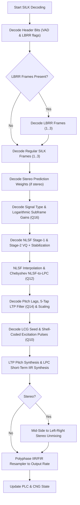
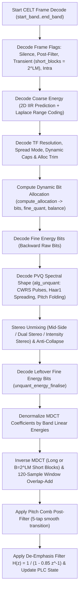

# Symphonia Opus Codec: SILK, CELT, and Hybrid Decoder Implementation in Rust

## Introduction

This presentation covers the architecture and implementation of the complete Opus audio decoder in `symphonia-codec-opus`, including packet framing, range decoding, the SILK linear predictive layer, the CELT transform layer, Hybrid mode fusion, mode transitions, packet loss concealment (PLC), and Ogg Opus multi-stream surround decoding as specified in [RFC 6716](https://datatracker.ietf.org/doc/html/rfc6716) and [RFC 7845](https://datatracker.ietf.org/doc/html/rfc7845).

## Overview of the Opus Codec

Opus is a low-latency interactive audio codec standardized by the IETF in RFC 6716. It combines two complementary coding technologies within a single unified bitstream and range coder:

1. **SILK (Linear Predictive Coding)**: Optimized for speech signals from Narrowband (8 kHz) up to Wideband (16 kHz), operating on 10 ms, 20 ms, 40 ms, or 60 ms frames.
2. **CELT (Constrained Energy Lapped Transform)**: Optimized for music, transients, and fullband audio from Narrowband (8 kHz) up to Fullband (48 kHz), operating on 2.5 ms, 5 ms, 10 ms, or 20 ms MDCT frames.
3. **Hybrid Mode**: Simultaneously combines SILK for the low frequencies (`0..8 kHz`) and CELT for the high frequencies (`8..12 kHz` Super-Wideband or `8..20 kHz` Fullband) on 10 ms or 20 ms frames.

| Mode | TOC Configs | Bandwidths | Frame Durations | Active Layers |
| :--- | :--- | :--- | :--- | :--- |
| **SILK-only** | `0..=11` | NB (8 kHz), MB (12 kHz), WB (16 kHz) | 10, 20, 40, 60 ms | `silk::Decoder` |
| **Hybrid** | `12..=15` | SWB (24 kHz), FB (48 kHz) | 10, 20 ms | `silk::Decoder` (`0..8 kHz`) + `celt::Decoder` (bands `17..21`) |
| **CELT-only** | `16..=31` | NB (8 kHz), WB (16 kHz), SWB (24 kHz), FB (48 kHz) | 2.5, 5, 10, 20 ms | `celt::Decoder` (bands `0..end_band`) |

### Packet Organization for a Logical Ogg Opus Stream (RFC 7845)

```text
        Page 0         Pages 1 ... n        Pages (n+1) ...
     +------------+ +---+ +---+ ... +---+ +-----------+ +---------+ +--
     |            | |   | |   |     |   | |           | |         | |
     |+----------+| |+-----------------+| |+-------------------+ +-----
     |||ID Header|| ||  Comment Header || ||Audio Data Packet 1| | ...
     |+----------+| |+-----------------+| |+-------------------+ +-----
     |            | |   | |   |     |   | |           | |         | |
     +------------+ +---+ +---+ ... +---+ +-----------+ +---------+ +--
     ^      ^                           ^
     |      |                           |
     |      |                           Mandatory Page Break
     |      |
     |      ID header is contained on a single page
     |
     'Beginning Of Stream'
```

## Opus Packet Structure (RFC 6716 Section 3)

Each Opus packet consists of:

```text
+----------+--------------+---------+
| TOC Byte | Frame Packet | Padding |
+----------+--------------+---------+
```

- **TOC Byte**: Table of Contents byte indicating coding mode, audio bandwidth, stereo flag, and frame count code (`0..=3`).
- **Frame Packet**: Contains 1 to 48 frames totaling at most 120 ms of audio. Multi-stream packets pack `M + U - 1` self-delimited `FramePacket`s followed by 1 standard `FramePacket`.
- **Padding**: Optional padding bytes (Code 3 VBR/CBR packets) up to the total packet length.

### TOC Byte Structure

```text
  0 1 2 3 4 5 6 7
 +-+-+-+-+-+-+-+-+
 | config  |s| c |
 +-+-+-+-+-+-+-+-+
```

- **config** (bits 0..4): Encodes audio mode (SILK, Hybrid, or CELT), bandwidth, and frame duration (32 configurations).
- **s** (bit 5): Stereo flag (`0` for mono, `1` for stereo).
- **c** (bits 6..7): Frame count code (`0`: 1 frame, `1`: 2 equal frames, `2`: 2 variable frames, `3`: arbitrary CBR/VBR frames).

## Top-Level Opus Decoder Architecture

The Opus decoder (`OpusDecoder` / `StreamDecoder` in `decoder.rs`) coordinates the shared range decoder (`entropy::Decoder<'a>`), the SILK decoder (`silk::Decoder`), and the CELT decoder (`celt::Decoder`). At any given time, one or both of the SILK and CELT decoders are active. Their synthesized outputs are combined with sample-rate conversion and delay compensation on the SILK path, optional redundant 5 ms CELT transition crossfading, and multi-stream channel routing:

```text
                            +---------+    +------------+
                            |  SILK   |    |   Sample   |
                         +->| Decoder |--->|    Rate    |----+
   Bit-    +---------+   |  |         |    | Conversion |    v
   stream  |  Range  |---+  +---------+    +------------+  /---\  Audio
   ------->| Decoder |                                     | + |------>
           |         |---+  +---------+    +------------+  \---/
           +---------+   |  |  CELT   |    | Decimation |    ^
                         +->| Decoder |--->| (Optional) |----+
                            |         |    |            |
                            +---------+    +------------+
```

---

## Entropy Decoder (`entropy.rs`, RFC 6716 Section 4.1)

Every Opus frame is decoded using a dual-ended bitstream reader (`entropy::Decoder<'a>`):
- **Forward Range Coder**: Reads from the front of the frame byte slice, maintaining 32-bit interval width `rng` and offset `val` normalized to `2^23 < rng <= 2^24`. Supports inverse-CDF symbol decoding (`decode_symbol_with_icdf`), binary log-probability flags (`decode_symbol_logp`), uniform integers (`decode_uint`), and Laplace-distributed coarse energy deltas (`decode_laplace`).
- **Backward Raw-Bit Reader**: Reads raw bits (`decode_raw_bits`) from the end of the exact same frame byte slice toward the front (used by CELT for fine energy bits and PVQ sign/index bits).
- **Bit Budget Accounting**: `tell()` and `tell_frac()` report the exact number of whole and fractional (`1/8`th) bits consumed by both ends of the buffer, driving CELT's dynamic bit allocation and SILK/Hybrid frame boundaries.

```text
Frame byte slice:  [ byte 0 | byte 1 | byte 2 | ... | byte N-2 | byte N-1 ]
                     -----> Forward Range Coder        Backward Raw Bits <-----
                     (SILK all symbols, CELT           (CELT fine energy bits,
                      flags, coarse energy, CWRS)       PVQ signs, LSBs)
```

---

## SILK Decoder (`silk/*`, RFC 6716 Section 4.2)

**SILK** reconstructs speech signals in the 8 kHz (NB), 12 kHz (MB), and 16 kHz (WB) internal sampling domains using fixed-point (`Q7`..`Q23`) Linear Predictive Coding (LPC) and Long-Term Pitch Prediction (LTP), followed by polyphase IIR/FIR resampling to the output sample rate (up to 48 kHz).

### SILK Decoder Block Diagram

```text
        +---------+    +------------+
     -->| Range   |--->| Decode     |---------------------------+
      1 | Decoder | 2  | Parameters |----------+       5        |
        +---------+    +------------+     4    |                |
                            3 |                |                |
                             \/               \/               \/
                       +------------+   +------------+   +------------+
                       | Generate   |-->| LTP        |-->| LPC        |
                       | Excitation |   | Synthesis  |   | Synthesis  |
                       +------------+   +------------+   +------------+
                                               ^                |
                                               |                |
                           +-------------------+----------------+
                           |                                      6
                           |   +------------+   +-------------+
                           +-->| Stereo     |-->| Sample Rate |-->
                               | Unmixing   | 7 | Conversion  | 8
                               +------------+   +-------------+
```

1. Range encoded bitstream
2. Coded parameters
3. Pulses, LSBs, and signs
4. Pitch lags, Long-Term Prediction (LTP) 5-tap coefficients (`Q14`)
5. Linear Predictive Coding (LPC) 10/16-order coefficients (`Q12`) and subframe gains (`Q16`)
6. Decoded signal (mono or mid-side stereo)
7. Unmixed signal (mono or left-right stereo)
8. Resampled signal (48 kHz)

### SILK Bitstream Layout

```text
  +----------------------------------+
  |           Header Bits            |
  | +------------------------------+ |
  | |    VAD flag (1 bit/frame)    | |
  | +------------------------------+ |
  | |        LBRR flag (1 bit)     | |
  | +------------------------------+ |
  +----------------------------------+
  |      Per-Frame LBRR Flags        |
  |          (optional)              |
  +----------------------------------+
  |        LBRR Frames (1..3)        |
  |          (optional)              |
  +----------------------------------+
  |      Regular SILK Frames (1..3)  |
  | +------------------------------+ |
  | |     Stereo Weights (if st)   | |
  | |        Frame Type & Gains    | |
  | |   NLSF Stage-1 & Stage-2 VQ  | |
  | |   LSF Interpolation Weight   | |
  | |  Pitch Lags & 5-tap LTP VQ   | |
  | |  LTP Scaling & LCG Seed      | |
  | |  Shell-Coded Excitation      | |
  | +------------------------------+ |
  +----------------------------------+
```

### SILK Decoding Pipeline



- **NLSF (Normalized Line Spectral Frequencies, `silk/lsf.rs`)**: Represents the 10th-order (NB/MB) or 16th-order (WB) LPC spectral envelope in the cosine domain (`Q15`), providing guaranteed filter stability after minimum-spacing stabilization and smooth 4-subframe interpolation before Chebyshev polynomial conversion to `Q12` LPC taps.
- **LTP (Long-Term Prediction, `silk/params.rs`, `silk/synthesis.rs`)**: Models pitch periodicity in voiced speech using a 5-tap pitch filter (`Q14`) per 5 ms subframe and primary/contour pitch lags (`16..288` samples).
- **LPC & Stereo Unmixing (`silk/synthesis.rs`)**: Reconstructs the formant structure via a short-term `Q12` IIR filter and unmixes mid-side stereo into left-right channels using interpolated `Q13` stereo weights.
- **Polyphase Resampler (`silk/resampler.rs`)**: Converts 8, 12, or 16 kHz SILK PCM to 8, 12, 16, 24, or 48 kHz output rates while maintaining the exact delay-line history needed for Hybrid alignment.
- **SILK PLC & Comfort Noise Generation (`silk/plc.rs`)**: Conceals lost frames (`silk_PLC`) via decaying voiced pitch synthesis or unvoiced sub-frame energy continuation, glues concealed-to-active transitions (`silk_PLC_glue_frames`), and synthesizes smoothed comfort noise (`silk_CNG`) during DTX silence.

---

## CELT Decoder (`celt/*`, RFC 6716 Section 4.3)

**CELT (Constrained Energy Lapped Transform)** operates in the frequency domain using Modified Discrete Cosine Transforms (MDCT) over 2.5 ms (`120` samples, $LM = 0$), 5 ms (`240` samples, $LM = 1$), 10 ms (`480` samples, $LM = 2$), or 20 ms (`960` samples, $LM = 3$) frames at 48 kHz. It divides the spectrum into up to **21 Bark-scaled frequency bands** (`EBAND_5MS`), separating the **spectral envelope** (band energies) from the **unit-norm spectral shape** (Pyramid Vector Quantization).

### CELT Decoder Block Diagram (RFC 6716 Section 4.3)

```text
                                     +--+
                                     |  |
                                     |  +------------+
                                     |               |
                                     v               |
   +---------+    +--------+    +---------+     +----+----+
-->|  Range  |--->| Decode |--->|  Shape  |---->| Stereo  |--+
 1 | Decoder | 2  | Pulses | 3  | Unquant |     |  Unmix  |  |
   +---------+    +--------+    +---------+     +---------+  |
        |                            ^               ^       |
        | 4                          | 5             | 6     | 7
        |      +----------------+    |               |       |
        +----->|Bit Allocation &|----+---------------+       |
        |      |    Parameters   |                            |
        |      +----------------+                            v
        |                                                 /-----\
        | 8    +----------------+    +--------------+     |  x  |---+
        +----->| Decode  Coarse |--->| Decode Fine  |---->|     |   |
               |     Energy     | 9  |    Energy    | 10  \-----/   |
               +----------------+    +--------------+               |
                                                                    |
        +-----------------------------------------------------------+
        | 11
        v
   +---------+    +------------+    +---------------+
   | Inverse |--->| Windowing &|--->| Post-Filter & |-->
   |  MDCT   | 12 | Overlap-Add| 13 |  De-Emphasis  | 14
   +---------+    +------------+    +---------------+
```

1. Range encoded bitstream (`entropy::Decoder<'a>`)
2. Algebraic PVQ CWRS index, sign, and pitch-folding bits
3. Unit-norm band shape vectors $X$ ($\|X\|_2 = 1$)
4. Silence, transient, intra-energy, pitch post-filter, spread, trim, skip, and stereo flags
5. Per-band pulse bit allocation (`pulses[i]`, `fine_quant[i]`, `fine_priority[i]`)
6. Intensity stereo (`intensity`) and dual stereo (`dual_stereo`) parameters
7. Unmixed normalized MDCT coefficients per channel
8. Coarse energy Laplace symbols (`celt/energy.rs`)
9. Quantized coarse band log-energies (`Q10`)
10. Linear band amplitudes ($2^{\text{energy}}$) after fine & leftover energy refinement
11. Denormalized MDCT frequency coefficients
12. Time-domain windowed synthesis blocks (1 long IMDCT or $B = 2^{LM}$ short IMDCTs)
13. Overlap-added signal (`120` sample low-overlap window)
14. Comb-filtered and de-emphasized 48 kHz output PCM

### CELT Decoding Pipeline



### Key CELT Submodules

- **Coarse & Fine Energy Quantization (`celt/energy.rs`, RFC 6716 Section 4.3.2)**:
  - **Coarse Energy**: Encodes band log-energies (in 6 dB `DB6` units) using a 2D separable IIR predictor across time ($\alpha$, previous frame's energy) and frequency ($\beta$, previous band in the current frame), with Laplace-coded residuals.
  - **Fine & Final Energy**: Refines each band's energy by `fine_quant[i]` raw bits read from the end of the packet, and uses any remaining bit budget at the end of the frame (`unquant_energy_finalise`) to add 1 extra bit of precision to priority bands.
- **Dynamic Bit Allocation (`celt/rate.rs`, RFC 6716 Section 4.3.3)**:
  - Computes the exact per-band bit allocation from the remaining range-coder bit budget (`tell_frac()`), interpolating between static rate-allocation curves (`LOG_ALLOC`), applying `alloc_trim` tilt, and splitting each band's bits between fine energy and PVQ shape pulses (`CACHE_BITS` / `CACHE_INDEX`).
- **Pyramid Vector Quantization & CWRS (`celt/cwrs.rs`, `celt/vq.rs`, RFC 6716 Section 4.3.4)**:
  - **CWRS (`cwrs.rs`)**: Decodes a single combinatorial index $i \in [0, V(N, K))$ via `entropy::Decoder::decode_uint` and unpacks $K$ signed integer pulses across $N$ band bins ($L_1$ norm $\sum |y_j| = K$).
  - **Spreading & Folding (`vq.rs`)**: Projects the integer pulse vector onto the unit $L_2$ sphere, applies orthogonal `exp_rotation` (`Haar1`) spreading rotations to prevent tonal artifacts at low bitrates, and fills zero-pulse bands by folding spectral content from lower frequencies (`intra_fold`) or the previous frame.
  - **Stereo Unmixing & Anti-Collapse (`vq.rs`)**: Reconstructs mid-side stereo using `theta` (`itheta`) angle quantization, supports dual-stereo independent channel coding and high-frequency intensity stereo, and injects pseudo-random noise (`renormalise_vector`) into transient bands that received zero pulses (`anti_collapse`).
- **IMDCT, Comb Post-Filter, De-Emphasis & PLC (`celt/mdct.rs`, `celt/decoder.rs`, RFC 6716 Sections 4.3.5 - 4.3.7)**:
  - **IMDCT & Overlap-Add**: Wraps `symphonia_core::dsp::mdct::Imdct` for both single long blocks ($N = 120 \cdot 2^{LM}$) and transient short blocks ($B = 2^{LM}$ blocks of length $120$), applying the 120-sample CELT Vorbis-derived window (`CELT_WINDOW`).
  - **Comb Post-Filter**: Applies a time-domain 5-tap pitch comb filter (`Tapset 0..=2`) with smooth crossfading over the 120-sample overlap region to suppress harmonic quantization noise.
  - **De-Emphasis**: Applies the inverse pre-emphasis filter $y[n] = x[n] + 0.85 \cdot y[n-1]$ (`PREEMPH_COEF = 0.85`).
  - **CELT PLC**: On packet loss (`decode_lost_frame`), performs 2x-downsampled autocorrelation pitch search (`pitch_downsample`, `pitch_search`) over the 1024-sample history buffer for the first two losses to extrapolate periodic audio with window crossfading, then transitions to shaped comfort noise on subsequent losses.

---

## Hybrid Mode & Mode Transitions (`decoder.rs`, RFC 6716 Sections 3.1, 4.3, 4.4)

### Hybrid Mode (`AudioMode::Hybrid`)

In Hybrid mode (TOC configurations `12..=15`, Super-Wideband 24 kHz or Fullband 48 kHz, 10 ms or 20 ms frames), both decoders share the **exact same `entropy::Decoder<'a>`** instance over a single frame byte slice:

```text
  Shared Frame Byte Slice & entropy::Decoder<'a>
  +-----------------------------------+-----------------------------------+
  | 1. SILK Layer (0..8 kHz WB)       | 2. CELT Layer (8..20 kHz, B17..21)|
  | - Decodes VAD/LBRR, gains, NLSF,  | - Starts at current range coder   |
  |   LTP, LPC, shell excitation      |   state with start_band = 17      |
  | - Resamples 16 kHz -> Fs          | - Decodes coarse/fine energy,     |
  | - Delayed by Fs / 250 samples     |   PVQ shape, IMDCT for bands 17+  |
  +-----------------------------------+-----------------------------------+
                   |                                     |
                   +------------------+------------------+
                                      |
                                      v
                    out_pcm[i] = silk_pcm[i] + celt_pcm[i]
```

1. **SILK First (`0..8 kHz`)**: `silk_decoder.decode_silk_frame_from_range` decodes the 16 kHz Wideband low-frequency signal, resamples it to the output rate $F_s$, and applies the `DEC_API_DELAY` (`Fs / 250` samples = 192 samples at 48 kHz) delay compensation so SILK's lookahead/resampler delay aligns in phase with CELT's 2.5 ms MDCT overlap.
2. **Optional Redundancy Flag**: If at least 37 bits remain in the range coder (`tell() + 37 <= 8 * len`), 1 log-probability bit (`logp = 12`) signals whether a redundant 5 ms CELT transition frame is appended at the end of the packet.
3. **CELT Second (`8..20 kHz`, Bands `17..21`)**: `celt_decoder.decode_frame_with_bounds(..., start_band = 17, end_band)` continues reading from the same `entropy::Decoder<'a>`, synthesizing only bands `17..end_band` (above 8 kHz) while zeroing bands `0..17`.
4. **Sample Summation**: The high-frequency CELT time-domain signal is added directly (`silk_pcm[i] += celt_pcm[i]`) to the delay-compensated SILK signal.

### Seamless Mode Transitions & 5 ms Redundant CELT Frames (RFC 6716 Section 4.4)

Switching between a linear predictive time-domain coder (SILK/Hybrid) and a lapped MDCT transform coder (CELT-only) requires bridging the difference in algorithmic delay and MDCT overlap:

- **CELT -> SILK/Hybrid (`celt_to_silk == true`)**:
  - When transitioning from CELT-only into SILK or Hybrid, the encoder embeds a 5 ms (`F120`, 240 samples at 48 kHz) **redundant CELT frame** at the end of the packet.
  - The decoder runs `decode_redundant_celt_frame` *before* the new frame's CELT layer and crossfades the first 2.5 ms (`F240`) of the new SILK output with the second half of the redundant 5 ms CELT output using the squared-sine window (`smooth_fade_into_second`).
- **SILK/Hybrid -> CELT (`celt_to_silk == false`)**:
  - When transitioning from SILK/Hybrid into CELT-only, the decoder advances the departing SILK decoder by 5 ms via PLC concealment (`conceal_up_to_20ms`), decodes the redundant 5 ms CELT frame (if present) to prime the CELT overlap buffer, and crossfades the departing SILK tail into the arriving CELT output (`smooth_fade_from_first`).

---

## Ogg Opus Multi-Stream Surround Decoding (`header.rs`, `decoder.rs`, RFC 7845 Section 5.1.1)

`OpusDecoder` supports both single-stream (`ChannelMappingFamily::Rtp`, Family 0, 1..2 channels) and multi-stream Vorbis surround (`ChannelMappingFamily::Vorbis`, Family 1, 1..8 channels) configurations parsed from the `OpusHead` identification header:

```text
  Multi-Stream Opus Packet:
  +---------------------------+---------------------------+-----------------------+
  | Stream 0 (Self-Delimited) | Stream 1 (Self-Delimited) | Stream N-1 (Standard) |
  +---------------------------+---------------------------+-----------------------+
                |                           |                         |
                v                           v                         v
      StreamDecoder[0]            StreamDecoder[1]          StreamDecoder[N-1]
     (Coupled Stereo: 2ch)       (Coupled Stereo: 2ch)      (Uncoupled Mono: 1ch)
                |                           |                         |
                +---------------------------+-------------------------+
                                            |
                                            v
                    Channel Mapping Table (e.g., 5.1 Vorbis Order)
                    + Q7.8 dB Output Gain Scaling (10^(gain / (20 * 256)))
                                            |
                                            v
                              Output AudioBuffer<f32>
```

- **Zero Per-Packet Heap Allocation**: `OpusDecoder` pre-allocates reusable planar scratch buffers (`scratch_ch0`, `scratch_ch1`: `[f32; 5760]`), decoding each elementary `StreamDecoder` in-place and routing its decoded channels directly into the output `AudioBuffer<f32>` planes according to `channel_mapping` (`0..2*M` -> coupled stream left/right, `2*M..M+U` -> uncoupled mono stream, `255` -> silent plane).
- **Combined Final Range State**: After decoding all elementary streams, `OpusDecoder::final_range()` computes the XOR combination (`combined_rng ^= stream.range_final`) specified by RFC 6716 Section 6.1 for bit-exact bitstream verification.

## Conclusion

The `symphonia-codec-opus` crate provides a complete, 100% safe Rust (`#![forbid(unsafe_code)]`) implementation of RFC 6716 and RFC 7845 across SILK, CELT, Hybrid, PLC/CNG, mode transitions, and multi-stream surround audio, verified against both `libopus` C oracle intermediate dumps and the official IETF RFC 6716 / RFC 8251 conformance test vectors (`testvector01`..`testvector12`).

## References

- RFC 6716: [Definition of the Opus Audio Codec](https://datatracker.ietf.org/doc/html/rfc6716)
- RFC 7845: [Ogg Encapsulation for the Opus Audio Codec](https://datatracker.ietf.org/doc/html/rfc7845)
- RFC 8251: [Updates to the Opus Audio Codec](https://datatracker.ietf.org/doc/html/rfc8251)
- Symphonia Project: [GitHub Repository](https://github.com/pdeljanov/Symphonia)
- Opus Codec: [Official Website](https://opus-codec.org)